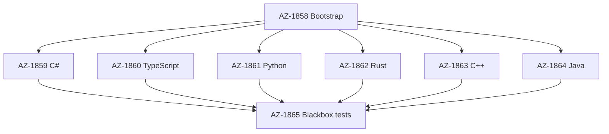

# Epics — packbin

LESSONS.md is absent. No estimation lesson applies.

Cross-cutting epics: none. The library does not log, authenticate, or load configuration. Registry tokens stay in GitHub Actions secrets.

Tracker: Jira project AZ on denyspopov.atlassian.net.

## Order

| Order | Key | Epic | Type | Effort | Depends on |
|-------|-----|------|------|--------|------------|
| 1 | AZ-1858 | Bootstrap and initial structure | bootstrap | M / 5 | — |
| 2 | AZ-1859 | C# package | component | M / 5 | AZ-1858 |
| 2 | AZ-1860 | TypeScript package | component | M / 5 | AZ-1858 |
| 2 | AZ-1861 | Python package | component | M / 5 | AZ-1858 |
| 2 | AZ-1862 | Rust package | component | M / 5 | AZ-1858 |
| 2 | AZ-1863 | C++ package | component | M / 5 | AZ-1858 |
| 2 | AZ-1864 | Java package | component | M / 5 | AZ-1858 |
| 3 | AZ-1865 | Blackbox tests | tests | M / 5 | the six packages |
| 4 | AZ-2018 | Pack session | feature | L / 13 | the six packages |
| 5 | AZ-2222 | Go package (full parity) | component | L / 45 (estimate ~26 in 2026-10-06) | the six packages |
| 6 | AZ-2223 | Swift package (full parity) | component | L / ~26 | the six packages |

The six language epics are the same order. Each is pack, unpack, and that registry's publish. Full descriptions are on the Jira issues.

Go (AZ-2222) was built in loop 24 (2026-10-13): implement complete, Jira In Testing; the loop 24 total review is PASS_WITH_WARNINGS and the feature assessment CLARIFY (12 covered, 2 out of scope, 1 clear gap, 7 unclear gaps, all on the loop 25 handoff). No Go tag has been pushed. Its 12 child tasks (specs in `_docs/02_tasks/done/`):

| Key | Task | Points |
|-----|------|--------|
| AZ-2440 | Go core: module, scalars, flags, `when`, errors, dispatch, typed and map rows | 5 |
| AZ-2441 | Scheme construction checks and the anchored group | 5 (grew from 3 with the anchored group) |
| AZ-2442 | Rounds and counted kinds: `repeat`, `times`, `sized`, two-bit slots, `bits`, `packed` | 5 |
| AZ-2443 | Strings, lists, dicts and nested rows | 5 |
| AZ-2444 | Round limits, pack budgets and unpack fuzzing | 3 |
| AZ-2445 | `PackSession` matching C# | 3 |
| AZ-2446 | Hostile vectors and the seventh package in the case checker | 3 |
| AZ-2447 | TypeScript parity tables | 3 |
| AZ-2448 | Go in the CI suite | 3 |
| AZ-2449 | Go in the language-pair ring | 3 |
| AZ-2450 | Release: ADR-004, golden gate, `go/vX.Y.Z` tag, proxy check | 5 |
| AZ-2451 | README Go section, `Example` tests, docs | 2 |

Total 45 points (the batch report counted 43 before AZ-2441 grew to 5). Go and Swift (2026-10-06) each cover every feature the six packages have: the wire format, schemes, strings, lists, dicts, the session, round limits, hostile vectors, the language-pair ring, and CI. Neither has a registry upload. Both install from a git tag, so their open decisions are about tag and manifest layout (Go `go/vX.Y.Z` tags; Swift `Package.swift` at the repository root). These are listed on the Jira issues.
